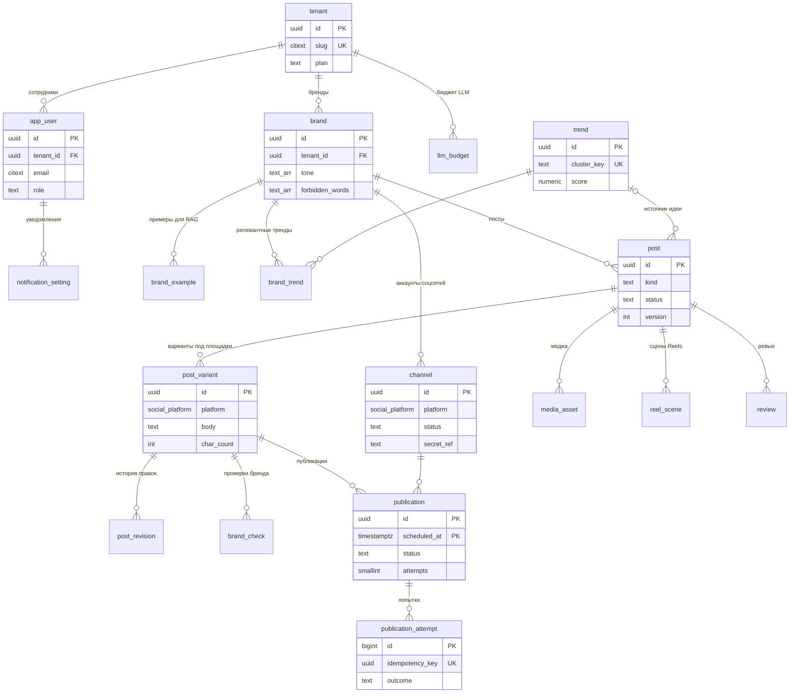

# Схема базы данных

PostgreSQL 17, база `rabbot`, схема `core`. Миграции — [`db/migration`](../../db/migration) (Flyway), демо-данные — [`db/seed`](../../db/seed).

## ER-диаграмма



Служебные таблицы без связей: `outbox_event`, `processed_message`, `audit_log`.

## Таблицы

| Миграция | Таблицы | Назначение |
|---|---|---|
| V1 | — | `citext`, `pg_trgm`, домен `social_platform`, функция `set_updated_at()` |
| V2 | `tenant`, `app_user`, `notification_setting` | Организации, пользователи (аутентификация в Keycloak), матрица уведомлений |
| V3 | `brand`, `brand_example` | Профиль бренда и примеры постов (векторы — в Qdrant) |
| V4 | `channel` | Подключённые аккаунты соцсетей; токены — в Vault, в БД только `secret_ref` |
| V5 | `trend`, `brand_trend` | Кластеры трендов (общие) и их релевантность бренду |
| V6 | `post`, `post_variant`, `post_revision`, `media_asset`, `reel_scene`, `review`, `brand_check` | Контент и его жизненный цикл |
| V7 | `publication` (партиционирована), `publication_attempt` | Расписание и попытки публикации |
| V8 | `outbox_event`, `processed_message` | Transactional outbox и идемпотентные консьюмеры |
| V9 | `llm_budget`, `audit_log` | Бюджет облачных LLM, журнал действий |

## Соглашения

- **Ключи** — `uuid` (`gen_random_uuid()`), для журналов — `bigint identity`.
- **Время** — только `timestamptz`, сервер в UTC.
- **Статусы** — `text` + `CHECK`, а не `ENUM`: новое значение добавляется миграцией без блокировок типа.
- **Мультитенантность** — `tenant_id` в каждой таблице; дочерние таблицы ссылаются составным ключом `(tenant_id, id)`, поэтому строку нельзя привязать к объекту другого тенанта даже при ошибке в коде.
- **`updated_at`** обновляется триггером `set_updated_at()`.
- **Optimistic locking** — колонка `post.version` (JPA `@Version`).
- **Секреты** в БД не хранятся.

## Роли

| Роль | Права | Кто использует |
|---|---|---|
| `postgres` | суперпользователь | только администрирование |
| `rabbot_migrator` | владелец схемы `core`, DDL | Flyway |
| `rabbot_app` | `SELECT/INSERT/UPDATE/DELETE`, `EXECUTE` | сервисы приложения |

Права для `rabbot_app` выдаются через `ALTER DEFAULT PRIVILEGES`, поэтому новые таблицы из миграций доступны приложению автоматически.

## Публикации

`publication` партиционирована по месяцам по `scheduled_at` (UTC). Первичный ключ — `(id, scheduled_at)`, так требует партиционирование.

Выборка планировщика — читается только текущая партиция, частичный индекс `publication_due_idx`:

```sql
SELECT id, scheduled_at
FROM publication
WHERE status = 'SCHEDULED'
  AND scheduled_at >= now() - interval '1 hour'
  AND scheduled_at <  now() + interval '1 minute'
ORDER BY scheduled_at
LIMIT 500
FOR UPDATE SKIP LOCKED;
```

Новые партиции создаёт функция (идемпотентна, вызывать раз в сутки из `scheduler`):

```sql
SELECT ensure_publication_partitions(date_trunc('month', now())::date, 3);
```

Строки вне созданных диапазонов попадают в `publication_default`. Если в `default` есть строки за месяц, партицию для этого месяца создать нельзя — сначала перенесите их.